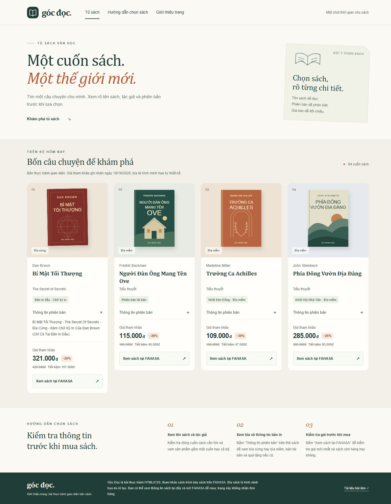
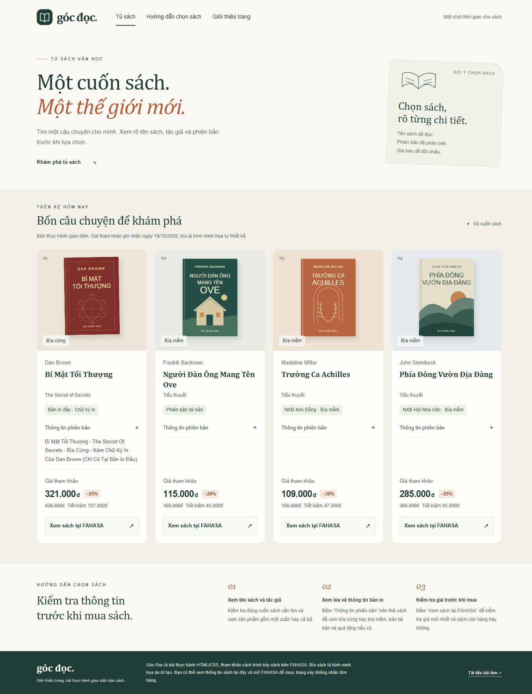

# Góc Đọc - Bài cá nhân Buổi 2: HTML5 và CSS3

**Sinh viên:** Nguyễn Quang Đức. Bài thực hành tiếp tục website Buổi 1 trong cùng repository, tập trung cải thiện khu vực bốn thẻ sách `section#tu-sach`.

- [Xem website](https://quangduc-qidu.github.io/ptudtmdt-chuong1-fahasa-ui/).
- [Repository](https://github.com/QuangDuc-qidu/ptudtmdt-chuong1-fahasa-ui).
- [Báo cáo thực hành theo tám bước](docs/BAO_CAO_BUOI2.md).
- [Báo cáo kiểm thử, lỗi và cách sửa](docs/KIEM_THU.md).
- [Bảy câu hỏi kiến thức](docs/CAU_HOI_KIEN_THUC.md).
- [Khảo sát Buổi 1](KHAO_SAT.md), [nhật ký sử dụng AI](AI_USAGE.md).

## 1. Website tham khảo và phạm vi cải thiện

Website tham khảo: [FAHASA](https://www.fahasa.com/), nhóm sách Văn học. Bảng khảo sát và các nguồn được giữ trong `KHAO_SAT.md`. Bản thực hành Góc Đọc kế thừa bốn sách, hình minh họa và nội dung từ Buổi 1 tại commit `93eca59`; không tạo website mới.

Các nhận xét dưới đây áp dụng cho bản Góc Đọc trước cải tiến, không phải nhận xét mới về website FAHASA.

| Vấn đề | Hướng cải thiện | Kết quả |
|---|---|---|
| Mở thông tin sách làm nút lệch hàng | Grid stretch; Flexbox theo cột; margin tự động cho giá | Các nút cùng hàng khi mở sách đầu |
| Một số chữ phụ chỉ 11 px | Tăng lên 12 px; padding nội dung thành 20 px | Chữ và khoảng cách rõ hơn |
| Nút và vùng mở thông tin thiếu phản hồi nhẹ | Transition màu 0,2 giây; hover gạch chân; giữ focus | Có phản hồi chuột và bàn phím |
| Nhãn Bìa cứng/Bìa mềm chỉ 10 px | Tăng `.binding-label` thành 12 px | Không vượt khung ở ba kích thước |

## 2. Kỹ thuật đã thực hành

- HTML semantic: `header`, `nav`, `main`, `section`, `article`, `footer`; thứ bậc `h1/h2/h3`; ảnh có alt; liên kết điều hướng và danh sách hướng dẫn.
- Bổ sung `time datetime` cho ngày tham khảo giá; liên kết phần lưu ý bằng `aria-describedby`.
- CSS ngoài trong `css/style.css`; selector phần tử, class và hậu duệ.
- Box Model: margin, padding, border, border-radius và `box-sizing: border-box`.
- Flexbox cho menu, giá và nút; Flexbox theo cột để bố trí nội dung trong thẻ.
- Grid bốn cột, hai cột ở tối đa 1050 px và một cột ở tối đa 600 px.
- `:hover`, `:focus-visible`, transition và quy tắc giảm chuyển động.
- `details/summary` mở thông tin phiên bản bằng HTML có sẵn. Không dùng JavaScript, backend hoặc framework CSS.

## 3. Cách chạy và đối chiếu

Giải nén rồi mở `index.html` bằng Chrome. Giữ `css/` và `images/` cạnh file HTML; không cần cài thư viện hay build. Có thể dùng Live Server trong VS Code nếu đã cài.

Mở `before/index.html` để đối chiếu mã Buổi 1. Thư mục `before/` chỉ giữ HTML, CSS và ảnh gốc phục vụ kiểm chứng.

## 4. Ảnh trước và sau

Trước: mở thông tin sách đầu làm nút thấp hơn các nút còn lại 78 px.



Sau: các thẻ cùng hàng giãn chiều cao, giá và nút nằm thẳng hàng.



[Giao diện hoàn thiện 1366 px](screenshots/final-desktop.png) · [768 px](screenshots/final-768.png) · [390 px](screenshots/final-390.png). Các ảnh còn lại và phương pháp đo nằm trong báo cáo kiểm thử.

## 5. Kết quả kiểm tra

Ngày 04/11/2026, Codex chạy lại trên trình duyệt ở 1366, 768 và 390 px: bố cục lần lượt 4/2/1 cột, không tràn ngang; bốn ảnh tải được; nhãn bìa 12 px nằm trong thẻ; các liên kết neo có đích; mở/đóng thông tin bằng chuột và Enter, chuyển focus bằng Tab hoạt động.

Đã chạy biến thể `justify-content: center` và Grid ba cột trên bản sao để quan sát; mã chính giữ `space-between` và bố cục 4/2/1. Xem [kết quả chi tiết](docs/KIEM_THU.md).

## 6. Nguồn và giới hạn

Bốn bìa SVG do AI tạo để minh họa, không phải bìa phát hành. Tên sách, tác giả và giá tham khảo kế thừa khảo sát ngày 19/10/2026; giá không tự cập nhật. Liên kết sách trỏ tới trang tương ứng tại FAHASA; trang thực hành không nhận đơn hàng.

Codex hỗ trợ hoàn thiện mã, tài liệu và kiểm thử. Nhật ký `AI_USAGE.md` đã bổ sung quá trình Buổi 2. Ngày 04/11/2026, Nguyễn Quang Đức xác nhận đã tự sửa nhãn bìa từ 10 lên 12 px và mở trang kiểm tra. Các số đo, ảnh kiểm thử nhiều kích thước và thực nghiệm bố cục là kết quả kiểm tra của Codex; phần sinh viên tự làm được ghi riêng trong nhật ký.

## 7. Cấu trúc bài

```text
index.html
css/style.css
images/                  # Bốn bìa SVG kế thừa Buổi 1
before/                  # HTML/CSS/ảnh Buổi 1 để so sánh
screenshots/             # Ảnh thực tế trước/sau và kiểm thử
docs/BAO_CAO_BUOI2.md
docs/KIEM_THU.md
docs/CAU_HOI_KIEN_THUC.md
KHAO_SAT.md
AI_USAGE.md               # Nhật ký Buổi 1 và Buổi 2
```
