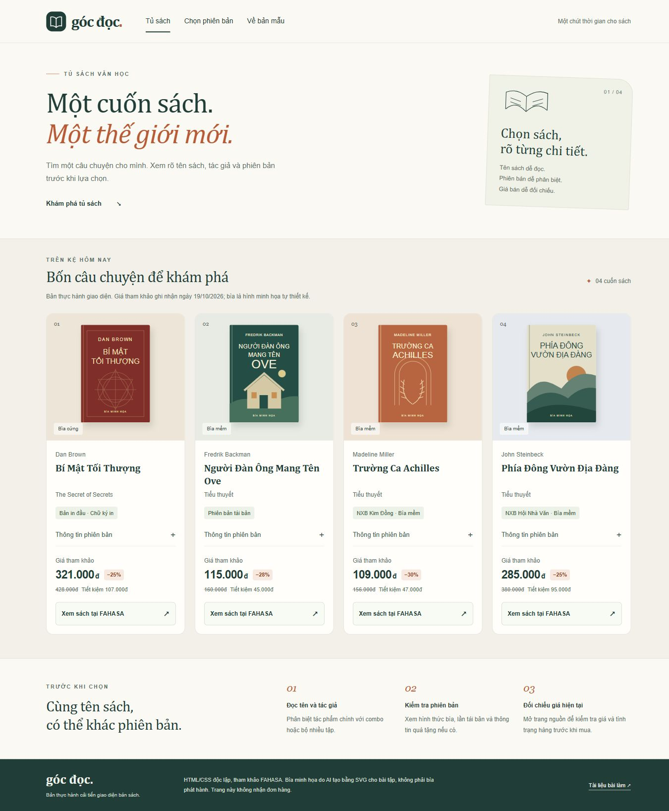
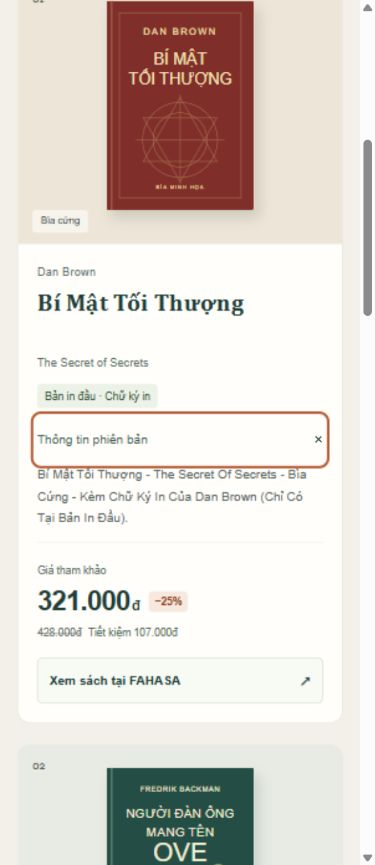

# Cải tiến thẻ sách bằng HTML và CSS

Bài cá nhân Chương 1 môn Phát triển ứng dụng TMĐT. Website khảo sát là [FAHASA](https://www.fahasa.com/). Sản phẩm thực hành là **Góc Đọc**, một trang độc lập để minh họa cách trình bày tên sách, tác giả, phiên bản và giá rõ ràng hơn.

## 1. Vấn đề và phạm vi cải tiến

Trong phiên khảo sát ngày **19/10/2026**, tại danh mục Văn học, tên một số sách dài chỉ hiển thị khoảng hai dòng. Ví dụ tên đầy đủ của **Bí Mật Tối Thượng** còn có thông tin bìa cứng và chữ ký in ở phía sau, nhưng phần này bị khuất trên thẻ danh sách. Đây là một đánh đổi về bố cục, không phải kết luận toàn bộ website khó sử dụng.

Bản cải tiến tách tên tác phẩm, tác giả và phiên bản thành các phần riêng. Người xem mở **Thông tin phiên bản** để đọc tên đầy đủ mà không cần thao tác rê chuột. Giá bán tham khảo, giá bìa, phần trăm giảm và số tiền chênh lệch được trình bày riêng.

## 2. Website tham khảo và kết quả khảo sát

- Website: FAHASA, https://www.fahasa.com/.
- Phạm vi: tìm và mua sách; khảo sát đủ trang chủ, danh mục, chi tiết sách, tìm kiếm và giỏ hàng.
- [Bảng khảo sát 5 khu vực](KHAO_SAT.md).
- [Căn cứ và phương án thiết kế](docs/THIET_KE.md).
- [Nguồn dữ liệu và hình ảnh](docs/NGUON_DU_LIEU.md).

## 3. Chức năng có trong bản HTML/CSS

- Bốn sách mẫu, mỗi sách có ảnh minh họa, tên, tác giả, phiên bản, giá và liên kết thao tác.
- Mở/đóng thông tin phiên bản bằng `details` và `summary` của HTML.
- Bố cục 4 cột trên máy tính, 2 cột trên tablet và 1 cột trên điện thoại.
- Điều hướng đến các phần trong trang; liên kết sang đúng trang sách trên FAHASA, mở tab mới.
- Trạng thái focus cho bàn phím, liên kết bỏ qua phần đầu trang, hỗ trợ giảm chuyển động.

Trang chỉ minh họa giao diện thẻ sách. Tìm kiếm, lọc, giỏ hàng, đăng nhập và thanh toán của cửa hàng không được xây lại trong bản mẫu. Trang không nhận đơn hàng.

## 4. Công nghệ và tài nguyên

- HTML5, CSS3; CSS tách riêng tại `css/style.css`.
- Không dùng JavaScript, framework, backend hoặc cơ sở dữ liệu.
- Bìa SVG được AI viết mới để minh họa, không sao chép bìa sách phát hành hoặc logo FAHASA.
- Tên sách và tác giả được đối chiếu với các trang nguồn. Giá được ghi nhận trong phiên khảo sát, có thể thay đổi; không phải giá chào bán của một cửa hàng thật trong dự án này.

## 5. Cách chạy

**Cách đơn giản:** mở `index.html` bằng Chrome. Giữ nguyên thư mục `css/` và `images/` cạnh file HTML để trang tải đúng tài nguyên. Không cần cài thư viện hay chạy lệnh build.

**Trong VS Code:** File → Open Folder → chọn thư mục này. Có thể dùng tiện ích Live Server nếu máy đã cài, nhưng tiện ích đó không bắt buộc.

**Kiểm tra điện thoại:** mở Chrome DevTools bằng F12, bật thanh thiết bị bằng Ctrl + Shift + M và chọn độ rộng 390 px. Đây là mô phỏng kích thước, không phải kiểm thử trên điện thoại vật lý.

## 6. Cấu trúc bài làm

```text
bai-ca-nhan-fahasa/
├── index.html
├── css/style.css
├── images/                    # 4 bìa SVG tự thiết kế
├── KHAO_SAT.md
├── README.md
├── AI_USAGE.md
├── HUONG_DAN_NOP.md
└── docs/
    ├── THIET_KE.md
    ├── NGUON_DU_LIEU.md
    ├── GIAI_THICH_CODE.md
    ├── KIEM_THU.md
    ├── TU_KIEM_TRA_CA_NHAN.md
    ├── evidence/              # Ảnh khảo sát FAHASA
    └── preview/               # Ảnh bản cải tiến
```

## 7. Kiểm thử, AI và phần sinh viên thực hiện

- [Kết quả kiểm tra của AI](docs/KIEM_THU.md) ghi riêng những kiểm tra đã thực hiện.
- [Nhật ký sử dụng AI](AI_USAGE.md) nêu rõ việc khảo sát, thiết kế, viết code, tạo bìa và kiểm tra do AI hỗ trợ.
- [Giải thích code](docs/GIAI_THICH_CODE.md) dành cho người mới học.
- Sinh viên cần tự mở trang, đối chiếu nhận xét, sửa ít nhất một điểm do mình phát hiện và ghi tại [phiếu tự kiểm tra](docs/TU_KIEM_TRA_CA_NHAN.md). Không dùng kết quả kiểm tra của AI để nhận là mình đã tự làm những bước này.
- [Hướng dẫn đưa bài lên GitHub và nộp](HUONG_DAN_NOP.md).

## 8. Ảnh giao diện




